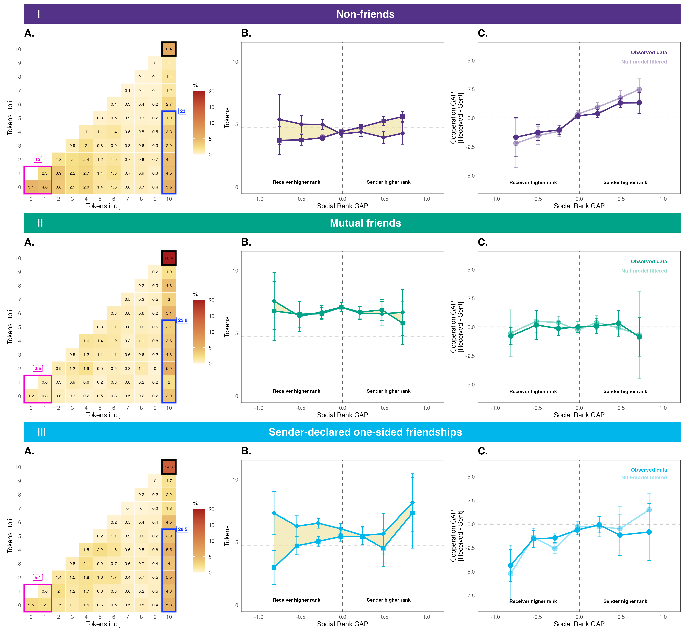

Figure 3 follows cooperative exchanges from the two transfers in each pair to their relationship with Social Rank. Explore its three columns independently, then view the complete nine-panel assembly.

| Page | What it shows | Jupyter notebook |
|---|---|---|
| [A · Exchange patterns](05_figure3a_exchange_patterns.qmd) | The three heatmaps and the percentages in each exchange region. | [Download](05_figure3a_exchange_patterns.ipynb) |
| [B · Tokens by rank](06_figure3b_tokens_by_rank.qmd) | Mean sent and received tokens: an explicit non-friend example, the reusable function, and the other relationship groups. | [Download](06_figure3b_tokens_by_rank.ipynb) |
| [C · Cooperation GAP](07_figure3c_cooperation_gap.qmd) | Observed and filtered GAPs: an explicit non-friend example, the reusable function, and the other relationship groups. | [Download](07_figure3c_cooperation_gap.ipynb) |
| [Complete assembly](figure3_assembly.qmd#complete-figure-3) | All nine panels with A–C labels and colored headers for rows I–III; downloadable PDF and PNG. | [Download](figure3_assembly.ipynb) |

## Complete Figure 3

{width=100% fig-alt="Complete Figure 3: nine panels in three relationship rows, with colored headers I–III and columns A–C."}

[Download PDF](figure3_assembled_20261121.pdf) · [Download PNG](figure3_assembled_20261121.png).

## Data and calculations

Each page reuses the main analysis data in the R session, reads `data/generated/main/analysis_dyads.csv`, or prepares the inputs on first use. [Data and measures](01_data_and_measures.qmd) explains the variables and filter. All Figure 3 notebooks can run independently. The descriptive summaries, seven rank intervals, and interval calculations are shared across B, C, and the assembly.

The asymmetric heatmap combines both nomination directions. The rank plots view asymmetric pairs from the child who nominated the partner. The C page explains the distinction between direction-specific filtered means and pairwise filtered regression data.

These pages create their plotting tables from `analysis_dyads`; the shared preparation does not create them. The tables stay in memory while the panels are built. The Figure 3 script saves them separately in `output/tables/`:

| Part | Object | Saved file |
|---|---|---|
| A. Exchange cells | `heatmap_cells` | `figure3_heatmap_cells.csv` |
| B–C. Child summaries | `children` | `figure3_children_summary.csv` |
| B–C. Rank intervals | `binned` | `figure3_binned_means.csv` |

## Reproduce Figure 3

Run this command from the repository root to reproduce Figure 3:

```sh
Rscript code/run_figure3.R
```

The assembled figure is written as `output/figures/figure3_assembled_20261121.pdf` and `.png`, alongside the individual panel exports. The command checks for the prepared main data and builds them if needed.



[Back to Main Results](index.qmd).
